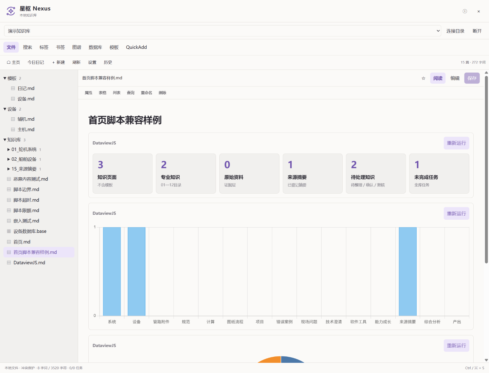

# 星枢 Nexus · Codex Forge 独立知识库插件

在 Codex Forge 中阅读、编辑和整理本地 Markdown 知识库，让模型参与笔记创作、资料关联和知识维护。

**独立安装 · 无需运行 Obsidian · 本地文件 · 模型工具 · 双向链接 · DataviewJS**

星枢使用 `homeftw.nexus` 插件 ID，通过 Forge 的公共 Nexus API 工作，兼容 Obsidian 文件格式与部分常用插件语法。它可以单独安装、启用、停用和卸载，不随 Forge 内置发行，也不需要 Obsidian 桥接插件。

[下载 Release](https://github.com/HOMEFTW/codex-forge-nexus/releases/latest) · [Forge 客户端](https://github.com/HOMEFTW/codex-forge) · [使用说明](docs/NEXUS.md) · [报告问题](https://github.com/HOMEFTW/codex-forge-nexus/issues)



## 安装与升级

| 要求 | 版本或说明 |
| --- | --- |
| 星枢 | 当前版本 **0.2.3** |
| Forge | **>= 0.4.2 且 < 0.6.0**，API 3 |
| Codex 桌面基线 | `26.1027.6604.0`（Forge 0.4.2）、`26.1029.7803.0`（Forge 0.4.3 / 0.4.4）、`26.1103.4239.0`（Forge 0.5.0 / 0.5.1）、`26.1103.7773.0`（Forge 0.5.2） |
| 已验证环境 | Windows、本地 NTFS 知识库 |

**Forge 0.4.1 无法运行本版本**：缺少自定义侧栏图标和 `nexus.script` 隔离 Worker 权限。新版官方客户端 `26.1103.7773.0` 需要配套 **Forge 0.5.2**；旧基线仍可使用上表对应的 Forge 版本。Forge 0.4.3 起已包含独立插件覆盖升级和完整视图遮挡修复。客户端由 [Forge 项目](https://github.com/HOMEFTW/codex-forge/releases) 单独发行，请使用与基线匹配的宿主。

1. 从 [v0.2.3 Release](https://github.com/HOMEFTW/codex-forge-nexus/releases/tag/v0.2.3) 下载 **`Nexus-0.2.3.zip`** 或 **`Nexus-0.2.3.forge-plugin.json`**。GitHub 自动生成的 `Source code` 压缩包是源码，不是可导入插件。
2. 打开 Forge「插件管理」→「导入插件包…」，选择下载的 ZIP 或 JSON。也可以解压 ZIP，通过「安装插件」选择其中的 `homeftw.nexus` 文件夹。
3. 检查权限并启用「星枢 Nexus」。导入后默认停用。
4. 点击**左侧边栏**的星形轨道图标，再点击「连接目录」，通过原生选择器选择知识库根目录。普通 Markdown 文件夹也可以连接。
5. 打开笔记即可阅读或编辑；`Ctrl/Cmd + S` 保存。DataviewJS 代码块需要点击「运行此查询」。

从 0.1.0 / 0.2.0 / 0.2.1 / 0.2.2 升级时，在 Forge 0.4.3 或更新版中直接导入 0.2.3，按提示重启，再检查启用状态。若已升级到 Forge 0.5.2，旧版星枢会因缺少新客户端基线而停用；导入新版后需要先重启，暂存阶段仍显示旧版本是正常现象。已经审阅且保持启用意愿的插件，在权限未变化时重启后恢复启用；主动停用的插件保持停用。也可先在旧宿主中升级星枢，再升级客户端。无需卸载，知识库连接与插件存储保留。如果更旧的客户端提示「插件已存在」，请先升级宿主。

插件停用或卸载后，笔记仍保留在原目录；宿主同时隐藏并拒绝星枢的模型工具。入口仅出现在左侧边栏，折叠后保留图标。

Release 提供 `SHA256SUMS.txt`。Windows 可用下面的命令核对下载内容：

```powershell
Get-FileHash .\Nexus-0.2.3.zip -Algorithm SHA256
```

## 能做什么

| 功能 | 当前实现 |
| --- | --- |
| 文件与编辑 | 文件夹树、笔记创建/阅读/编辑、属性与任务编辑、历史恢复、字词统计 |
| 阅读与排版 | Markdown、表格、任务列表、callout、wikilink、笔记/标题/块嵌入、脚注、高亮、KaTeX 公式、Mermaid 图 |
| 知识关联 | 标签列表、出链、反向链接、大纲、局部/全库关系图谱 |
| 搜索 | 文件、正文、路径、标签、短语、AND/OR/NOT 与括号条件 |
| 日常工作流 | 模板、日记、书签、Homepage 主页、QuickAdd Template/Capture |
| 数据库 | `.base` 的表格/卡片/列表视图，筛选、属性、排序、分组、部分公式与汇总 |
| 模型协作 | 检索与读取、创建与修改笔记、属性/任务/表格/列表操作、查询、模板、日记和兼容的 QuickAdd |

### 常用第三方插件兼容

星枢独立实现下列**常用子集**，不会加载这些插件的 JavaScript，也不承诺完整复刻其运行环境。

| 原插件 | 支持 | 主要边界 |
| --- | --- | --- |
| Advanced Tables | 表格渲染、格式对齐、增加/删除行列 | 不支持其公式引擎 |
| Charts | `chart` YAML；柱状、折线、饼图、环形、雷达、极坐标、散点图 | 不读取外部数据文件，不执行自定义图表回调 |
| Homepage | v4 File 主页配置和旧版字符串主页，笔记或 Base 主页 | 不复刻其他插件私有行为 |
| Outliner | 列表分支缩进、反缩进、上下移动 | 不复刻完整编辑器交互 |
| Templater | 文件标题/路径/目录、日期、frontmatter 等常用变量 | 不执行 `<%* ... %>`、系统命令或任意脚本 |
| Dataview | TABLE/LIST/TASK、筛选/排序/限额、部分分组、行内查询 | 查询语言与表达式为兼容子集 |
| DataviewJS | 点击运行的只读查询、DataArray、统计卡片、表格/列表、Charts 图表 | 没有 Obsidian app/vault、网络、任意文件 IO、完整 DOM 或完整 Luxon |
| QuickAdd | Multi、Template、Capture 和常用变量 | 不运行 Macro/AI/脚本，不支持复杂 Capture 插入定位 |

具体语法与限制见 [完整功能说明](docs/NEXUS.md) 和 [DataviewJS 兼容说明](docs/DATAVIEWJS.md)。PDF 内嵌预览、远程图片自动加载暂不支持；重命名会给出待更新引用列表，不会自动改写整个库的链接。

## DataviewJS 示例

下面的代码可直接放进笔记。打开笔记后点击「运行此查询」，会列出带有 `#设备` 标签的笔记及其 `功率` 属性：

````markdown
```dataviewjs
const pages = dv.pages("#设备").sort(p => p.功率, "desc");
dv.header(3, `设备笔记：${pages.length}`);
dv.table(["笔记", "功率"], pages.map(p => [p.file.link, p.功率]));
```
````

每个代码块在独立 Worker 中运行，只读取已连接库的元数据快照；不会因打开笔记而自动执行。4 秒超时或切换笔记时终止，输出 HTML 经清理后显示。`window.renderChart(config, this.container)` 可生成兼容图表。模型仍通过 `nexus_*` 读写与查询接口工作，宿主 MCP 不直接执行 DataviewJS。

## 让模型维护知识库

先在面板连接目录，再在支持 Forge MCP 工具的对话中提出具体需求，例如：

> 搜索知识库中关于燃油系统的笔记，列出重复内容和缺少来源的结论，先给我修改建议。

> 创建今天的日记，引用本周未完成的任务，保留原笔记中的任务状态。

> 读取这篇笔记及其反向链接，补全结构和术语说明，保留原有来源引用。

工具包括 `nexus_vaults`、`nexus_browse`、`nexus_read`、`nexus_query`、`nexus_write`、`nexus_edit`、`nexus_workflow`。已有文件必须先读取当前修订，再写入；外部修改冲突会被拒绝。模型只能访问用户已连接的库，不能自行连接任意目录。参数、权限和限额见 [API 文档](docs/NEXUS-API.md)。

## 权限与数据

| 权限 | 用途 |
| --- | --- |
| `panels`、`sidebar` | 插件面板及左侧入口 |
| `nexus.read`、`nexus.write` | 已连接库的读取、编辑和工作流 |
| `nexus.script` | 点击运行的 DataviewJS Worker；禁止与 `network` 并用 |
| `browser`、`conversation.read` | 把用户点击的 HTTP(S) 外链打开到当前对话的浏览器 |

插件不申请 `network`。界面及渲染依赖随包交付，无需 CDN。笔记保存回原目录，冲突检查和历史副本由 Forge 负责；备份不会自动清理。原 Obsidian 配置只在相应功能需要时读取，星枢设置使用单独的覆盖配置，书签操作会更新原格式书签文件。

本地存储并不表示模型推理离线：当你要求模型读取笔记时，工具返回的内容会进入该对话，并由其配置的模型服务处理。

## 从源码构建

需要 **Node.js 22 或更新版本**；本次发行在 Windows / Node.js 24.14.1 验证。

```powershell
git clone https://github.com/HOMEFTW/codex-forge-nexus.git
cd codex-forge-nexus
npm ci
npm run build
```

输出：

```text
dist/
  homeftw.nexus/                       # 可按目录安装
  Nexus-0.2.3.forge-plugin.json         # 可导入插件包
  Nexus-0.2.3.zip                      # Windows 构建时额外生成
  SHA256SUMS.txt
  build-info.json
```

构建不需要 Forge 源码。集成测试和本地预览使用 **Forge 0.5.2 / API 3** 宿主源码及其依赖；默认使用相邻的 `../codex-forge`，也可以指定路径：

```powershell
$env:FORGE_SOURCE = "D:\path\to\codex-forge"
npm --prefix $env:FORGE_SOURCE ci
npm test
npm run preview
```

`npm test` 包含真实 Forge registry/SDK/MCP 集成。仅运行不依赖宿主的 Dataview 逻辑测试：

```powershell
node --test tests/dataview.test.mjs
```

预览在 `output/playwright/` 创建虚构样例库并输出本机 URL，不使用用户的真实知识库。当前验证范围见 [验证说明](https://github.com/HOMEFTW/codex-forge-nexus/blob/main/docs/VALIDATION.md)。

源码布局：`src/` 为面板、渲染和 DataviewJS 运行层，`scripts/` 为构建与样例环境，`tests/` 为逻辑及宿主集成测试，`docs/` 为功能、API 和验证说明。本项目与 Forge 客户端分别维护；运行时不依赖宿主仓库中的 UI 源码。

## 许可证

项目代码沿用 Forge 的 [MIT License](LICENSE)。依赖保留各自许可证，构建包中的 `THIRD-PARTY-NOTICES.txt` 汇总随包分发的第三方声明。星枢与 Obsidian 及上述社区插件没有官方隶属关系。
